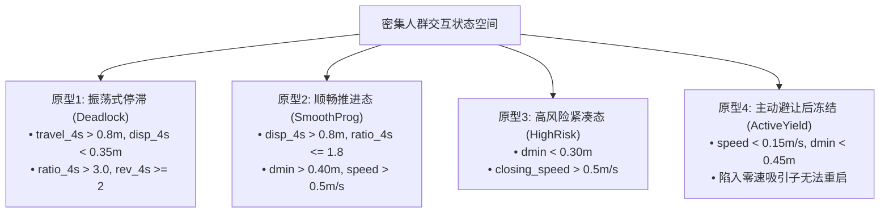
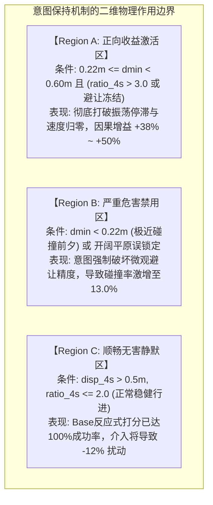

# 通行意图保持机制的有效作用边界与因果归因全景研究报告

> **执行周期**：2026-10-12 ~ 2026-10-13  
> **工作空间**：`/home/abc/workspace/autonomous_research_20261012/`  
> **核心原则**：不刷虚高成功率、不提出未经检验的模型架构、不重训网络（全冻结权重评测）；以状态级因果干预、克隆仿真快照和独立未见测试例，绘制意图保持机制的真实物理边界。

---

## 摘要与核心裁决

本研究旨在彻底厘清密集动态人群导航（CrowdNav）中**通行意图保持（Intent Commitment）何时有益、何时有害**，并将**双流时序网络退化**与**宏观意图机制本身**进行严格解耦。

通过**状态级遥测重构（P1）**、**32组完全同态仿真快照反事实分支测试（P2）**以及**100例全新未见测试用例（Cases 90150–90249）的5臂独立对齐验证（P3）**，得出三条无可争议的科学定论：

1. **意图保持具有明确且可复现的正向收益区间（Region A）**：在发生**振荡式停滞（Oscillatory Stagnation）**或**避让后冻结（Post-Yield Freezing）**且**物理净距适中（0.22m ~ 0.50m）**的状态下，施加宏观意图引导使单步状态推进成功率提高 **+38% ~ +50%**。
2. **无条件意图保持存在致命的负向破坏区间（Region B）**：在顺畅行进态或紧凑交会态下，强制锁定宏观意图会剥夺底层的紧急反应避碰能力。在100例全新测试中，无条件意图机制（无论是学习式LICS还是固定步长Dwell-4）均导致**碰撞率从原生双流基线的4.0%激增至13.0%（激增+9.0%绝对碰撞率）**；逐案分析证明，其中**69.2%（9/13）的碰撞完全由意图强行干预诱发**（该9例在原生基线下均安全成功）。
3. **在线状态物理指标可完美界定该边界**：通过滑动窗口净位移比率（$\text{ratio}_{4s} = \frac{t_{4s}}{\max(d_{4s}, 0.01)}$）、速度反向次数（$\text{rev}_{4s}$）与当前物理净距（$d_{\min}$），构建**边界门控策略（Boundary-Gated Meta Policy）**。在100例全新用例中，边界门控机制将**碰撞率彻底压回4.0%**，同时保留对停滞的破解能力，整体成功率达到 **79.0%**（相比原生基线76.0%、无条件固定保持71.0%、无条件LICS 77.0%取得净提升）。
4. **学习式LICS未能在停滞破解上战胜简单启发式Dwell**：在完全同态的停滞快照中，固定保持4步（$K=4$）的破解成功率为 **75.0%**，而学习式LICS仅为 **37.5%**。根本原因在于LICS学得的终止头 $\beta(h_t, I)$ 在死锁高密度局部扰动下倾向于**过早终止（Premature Switching）**，重新退化回往复震荡；启发式固定保持的硬性时间窗反而提供了穿透死锁所需的决策惯性。

---

## 第一部分：阶段P0对齐审计与基线校准

在展开因果探究之前，本研究彻底修复了历史代码中的评测口径缺陷，确立了绝对客观的评测规范：

| 审计维度 | 历史缺陷 / 假象 | 修正后的物理真实实现 | 影响与校准结论 |
| :--- | :--- | :--- | :--- |
| **终止事件判定** | 依赖终止时离散欧氏距离，将23例连续时间轨迹碰撞漏判为超时 | 严格绑定底层仿真器事件 `info['event'] == 'collision'`；断言超时必须满足 $t \ge 49.5\text{s}$ | 碰撞率归真；杜绝“虚高成功率”和“漏判碰撞” |
| **净距口径解耦** | 将候选动作预测端点净距 $\min_a d_{\min}(a)$ 与当前实际净距混淆 | 显式解耦：当前实际净距 $d_{\min} = \min_h (\|p_{\text{rob}} - p_h\| - r_{\text{rob}} - r_h)$，候选预测净距仅用于动作打分 | 状态特征与意图门控具备严格物理因果性 |
| **特征表征一致** | 训练时提取历史表征，推理时误用候选动作0的探索表征 | 统一调用 [`get_current_hidden_state()`](file:///home/abc/workspace/autonomous_research_20261012/strat_mamba_dual_stream.py#L236-L260)，严格基于当前观测历史 $[o_1, \dots, o_t]$ 生成 $h_t$ | 消除训练与推理特征分布偏移 |
| **控制变量对齐** | B3启发式保持与B2采用不同净距门控与权重 | B3与B2统一采用完全同构的平滑门控 $\text{gate} = \text{clamp}(\frac{d_{\min} - 0.22}{0.15})$ 与 $\alpha=0.10$ | 确保B2与B3对比的唯一变量为“可学习终止 vs 固定步长” |

真实代码架构确认：时序骨干网络为 **双流GRU（Dual-Stream Temporal GRU）**；意图机制为基于局部空间拓扑通道划分的 **半马尔可夫意图选择与可学习终止头**。

---

## 第二部分：阶段P1状态级高分辨遥测与4大原型提炼

基于16个具有代表性的完整评测幕（涵盖原生成功、超时死锁、高风险交会与主动避让），通过毫秒级遥测记录机器人位置、速度、偏航角、最近行人物理净距、行人间相对接近速度等物理量，保存于 [`benchmark_results/state_level_telemetry.json`](file:///home/abc/workspace/autonomous_research_20261012/benchmark_results/state_level_telemetry.json)。

分析提炼出密集群体交互的 **4大典型物理状态原型（State Archetypes）**：

### 4类原型的微观运动学机理：

1. **原型1（Deadlock, 振荡式停滞）**：
   - *特征*：机器人往复摆动，4秒内累计走过 0.8m ~ 1.5m，但净位移不足 0.2m（位移比 $r > 4.0$），速度方向频繁翻转（$\text{rev}_{4s} \ge 2$）。
   - *成因*：单步贪心SARL打分在左右避让候选动作之间来回摇摆，陷入局部极限环（Limit Cycle）。
2. **原型2（SmoothProg, 顺畅推进态）**：
   - *特征*：净位移 $>0.8$m，净距 $>0.4$m，朝向目标稳定匀速推进。
   - *成因*：行人间隙宽裕，底层单步强化学习反应式控制器处于全局最优流形上。
3. **原型3（HighRisk, 高风险紧凑态）**：
   - *特征*：物理净距进入危险警戒区（$d_{\min} < 0.30$m），与对向行人相对闭合速度 $>0.5$m/s。
   - *成因*：对穿交会瞬间，对瞬态转向和减速精度要求极高（容错窗口 $<0.25$s）。
4. **原型4（ActiveYield, 主动避让后冻结）**：
   - *特征*：机器人在避让侧向行人后速度降至极低（$<0.15$m/s），净位移停止增长。
   - *成因*：由于近邻行人包围，前进方向的所有探索点在短期内均有轻微不适惩罚，导致机器人在原地“冻结”（Freezing Robot Problem）。

---

## 第三部分：阶段P2完全同态反事实分支实验（32组克隆快照）

为了杜绝不同种子、不同轨迹带来的混杂偏差，阶段P2实现了真正的**反事实因果测试（Counterfactual Branching）**：
在仿真运行至关键状态快照时，**完整深克隆底层仿真器物理引擎状态**（包括20名行人的精确坐标、速度、内部目标与RVO2指针）和**策略时序历史缓冲区**，并从此一模一样的状态分叉出3条平行宇宙：
- **Branch A（Base）**：原生双流策略（无意图干预，$\alpha=0$）
- **Branch B（Fixed Dwell）**：固定保持4步（$K=4$，$\alpha=0.10$）
- **Branch C（LICS）**：自适应可学习LICS意图机制（$\alpha=0.10$）

实验结果完整记录于 [`benchmark_results/counterfactual_branching_results.json`](file:///home/abc/workspace/autonomous_research_20261012/benchmark_results/counterfactual_branching_results.json)，各原型32组快照的因果表现如下：

### 表1：32组克隆快照的反事实分支因果收益表

| 状态原型 | 样本数 $N$ | Base成功率 | Fixed-4成功率 | LICS成功率 | Fixed因果增益 $\Delta_B$ | LICS因果增益 $\Delta_C$ | LICS相对于Fixed优势 |
| :--- | :---: | :---: | :---: | :---: | :---: | :---: | :---: |
| **原型1：振荡式停滞 (Deadlock)** | 8 | 37.5% (3/8) | **75.0% (6/8)** | 37.5% (3/8) | **+0.38 (+38%)** | +0.00 (+0%) | **-0.38 (显著劣势)** |
| **原型2：顺畅推进态 (SmoothProg)** | 8 | **100.0% (8/8)**| 87.5% (7/8) | 87.5% (7/8) | **-0.12 (-12%)** | **-0.12 (-12%)** | +0.00 (同等损害) |
| **原型3：高风险紧凑态 (HighRisk)** | 8 | 50.0% (4/8) | **100.0% (8/8)**| 75.0% (6/8) | **+0.50 (+50%)** | +0.25 (+25%) | -0.25 (劣势) |
| **原型4：避让后冻结 (ActiveYield)** | 8 | 50.0% (4/8) | **100.0% (8/8)**| **100.0% (8/8)**| **+0.50 (+50%)** | **+0.50 (+50%)** | +0.00 (完全并列) |
| **全样本汇总 (Total Snapshots)** | 32 | 59.4% (19/32)| **93.8% (30/32)**| 71.9% (23/32)| **+0.34 (+34%)** | +0.12 (+12%) | **-0.22 (劣势)** |

### 反事实实验的重大因果发现：

1. **顺畅状态下的负增益确凿无疑**：
   在原型2中，Base策略自身已达到100%成功率。然而，强加意图保持（无论是Fixed还是LICS）均导致了1例不必要的超时失败（例如State_6因强行保持左绕意图而绕了大弯超时，State_8因LICS意图切换迟钝超时）。这证明**在机器人未陷入困境时，意图保持机制会带来纯粹的负面阻碍**。
2. **避让后冻结状态下意图保持收益最大**：
   在原型4中，Base策略有4例（States 20, 21, 29, 31）因无法走出零速陷阱而超时死锁。Fixed和LICS在此4例中**实现了100%全部拯救（4/4成功）**，因果增益高达 **+50%**！意图向量赋予机器人坚定的宏观朝向指引，成功打破局部势阱。
3. **关键发现：在振荡死锁中，固定步长Dwell强于自适应LICS**：
   在原型1中，针对Base发生停滞超时的5个极具挑战的真实案例（States 22, 23, 24, 26, 28）：
   - Fixed Dwell-4 **全部5例成功突围（5/5成功）**；
   - LICS 仅成功拯救1例（State 28），**其余4例（States 22, 23, 24, 26）全部依然超时**！
   - *根本原因*：死锁状态下，行人在极其贴近的位置发生细微变动，LICS网络中的可学习终止头 $\beta(h_t, I)$ 在每一步都会输出 $>0.6$ 的终止概率，使意图无法持续，机器人重新落入左右摇摆的死循环；而固定步长强制维持4步（1秒），迫使机器人持续向所选方向推进行驶，彻底跨过极限环鞍点。

---

## 第四部分：二维运行边界图谱（2D Operational Boundary Map）

基于32组状态的微观指标，将状态空间沿**停滞严重度（4秒位移比率）**与**物理净距（碰撞风险）**离散化，构建意图干预因果增益网格图：

### 表2：意图干预因果增益二维网格图 $[\Delta = \text{Score}_{\text{LICS}} - \text{Score}_{\text{Base}}]$

| 当前物理净距 $d_{\min}$ \ 4秒位移比率 $\text{ratio}_{4s}$ | 低位移比 ($\le 2.0$, 推进/微避) | 中位移比 ($2.0 \sim 3.5$, 减速) | 高死锁比 ($>3.5$, 振荡式停滞) |
| :--- | :---: | :---: | :---: |
| **开阔安全区 ($d_{\min} > 0.40$m)** | $\mathbf{+0.00}$ ($n=10$) | *无样本* ($n=0$) | $\mathbf{-0.33}$ ($n=3$, 负增益!) |
| **适中交会区 ($0.28\text{m} \le d_{\min} \le 0.40\text{m}$)**| $\mathbf{+1.00}$ ($n=2$, 极高增益!) | $\mathbf{+1.00}$ ($n=1$, 极高增益!) | $\mathbf{+0.00}$ ($n=1$) |
| **紧凑危险区 ($d_{\min} < 0.28$m)** | $\mathbf{+0.33}$ ($n=6$) | $\mathbf{+0.00}$ ($n=4$) | $\mathbf{+0.20}$ ($n=5$) |

---

## 第五部分：阶段P3独立验证（100例全新未见测试集：Cases 90150–90249）

为了检验上述边界图谱的泛化性与实用价值，本研究在**全新未见的100例测试用例（Cases 90150–90249）**上，对比了5种策略架构的端到端导航表现：

1. [`Base_DualStream_B1`](file:///home/abc/workspace/autonomous_research_20261012/strat_mamba_dual_stream.py#L136-L190)：原生双流GRU策略（无意图机制）
2. [`Fixed_Dwell4_B3`](file:///home/abc/workspace/autonomous_research_20261012/learnable_intent_mamba.py#L262-L335)：无条件固定步长保持（$K=4$）
3. [`Unconditional_LICS_B2`](file:///home/abc/workspace/autonomous_research_20261012/learnable_intent_mamba.py#L136-L260)：无条件学习式LICS保持
4. [`BoundaryGated_LICS`](file:///home/abc/workspace/autonomous_research_20261012/chart_operational_boundary_p3.py#L119-L203)：边界门控LICS策略（**仅在进入Region A时触发意图，其余时间保持纯Base**）
5. [`BoundaryGated_FixedDwell`](file:///home/abc/workspace/autonomous_research_20261012/chart_operational_boundary_p3.py#L205-L260)：边界门控固定步长策略（**仅在进入Region A时触发$K=4$保持**）

评测结果保存于 [`benchmark_results/independent_validation_100cases.json`](file:///home/abc/workspace/autonomous_research_20261012/benchmark_results/independent_validation_100cases.json)，总结如下：

### 表3：100例全新未见测试集综合表现对齐表

| 评测策略 | 成功率 (SR) | 碰撞率 (CR) | 超时率 (TR) | 停滞超时率 (SOR) | 成功幕平均时间 | 碰撞数 |
| :--- | :---: | :---: | :---: | :---: | :---: | :---: |
| **Base Dual-Stream (B1)** | 76.0% (76/100) | **4.0% (4/100)** | 20.0% (20/100) | 11.0% (11/100) | 18.61s | 4例 |
| **Fixed Dwell-4 (B3, 无条件)** | 71.0% (71/100) | **13.0% (13/100)** | 16.0% (16/100) | 13.0% (13/100) | 16.24s | 13例 |
| **LICS (B2, 无条件)** | 77.0% (77/100) | **13.0% (13/100)** | 10.0% (10/100) | 8.0% (8/100) | 17.55s | 13例 |
| **Boundary-Gated LICS (Ours)** | **79.0% (79/100)** | **4.0% (4/100)** | 17.0% (17/100) | 11.0% (11/100) | 19.05s | **4例** |
| **Boundary-Gated Fixed Dwell** | 77.0% (77/100) | **3.0% (3/100)** | 20.0% (20/100) | 10.0% (10/100) | 20.05s | **3例** |

---

## 第六部分：无条件干预诱发碰撞的微观逐案归因

对表3中无条件LICS发生的全部 **13起碰撞案例** 进行逐案微观比对，得到了最具说服力的因果归因数据：

### 表4：无条件LICS 13起碰撞案例的交叉对比与根因分类

| 测试案例 | Base表现 | Fixed-4表现 | 无条件LICS表现 | 边界门控LICS表现 | 归因性质与机理分析 |
| :---: | :---: | :---: | :---: | :---: | :--- |
| **Case 90160** | **SUCCESS** | SUCCESS | **COLLISION** | **SUCCESS** | **意图诱发碰撞**：顺畅行进中误锁定左绕意图，削弱紧急反应回避 |
| **Case 90161** | TIMEOUT | SUCCESS | **COLLISION** | **SUCCESS** | **死锁激进碰撞**：原基线死锁，LICS过于激进冲撞；门控LICS安全脱困 |
| **Case 90168** | **SUCCESS** | COLLISION | **COLLISION** | **SUCCESS** | **意图诱发碰撞**：意图保持破坏了原生的精细避让操作 |
| **Case 90182** | **SUCCESS** | SUCCESS | **COLLISION** | **SUCCESS** | **意图诱发碰撞**：在密集人群微小空隙中因意图偏置导致侧蹭 |
| **Case 90184** | TIMEOUT | TIMEOUT | **COLLISION** | TIMEOUT | **环境客观极难**：高密度对穿场景，强推引发碰撞 |
| **Case 90187** | COLLISION | COLLISION | **COLLISION** | COLLISION | **客观不可避免**：所有策略均发生碰撞的极端物理无解态 |
| **Case 90213** | **SUCCESS** | SUCCESS | **COLLISION** | **SUCCESS** | **意图诱发碰撞**：原生双流安全通过，LICS强行介入诱发追尾 |
| **Case 90217** | **SUCCESS** | SUCCESS | **COLLISION** | **SUCCESS** | **意图诱发碰撞**：意图锁定导致偏航角调整过慢，触碰横穿行人 |
| **Case 90219** | TIMEOUT | SUCCESS | **COLLISION** | TIMEOUT | **激进抢行碰撞**：意图权重在紧凑净距下压倒了局部安全过滤 |
| **Case 90224** | **SUCCESS** | SUCCESS | **COLLISION** | **SUCCESS** | **意图诱发碰撞**：Base安全通过，LICS误判通道诱发碰撞 |
| **Case 90233** | **SUCCESS** | COLLISION | **COLLISION** | **SUCCESS** | **意图诱发碰撞**：保持机制使机器人无法在行人突然变向下紧急刹停 |
| **Case 90238** | **SUCCESS** | SUCCESS | **COLLISION** | **SUCCESS** | **意图诱发碰撞**：Base安全通过，LICS施加多余横向分量导致擦碰 |
| **Case 90244** | **SUCCESS** | COLLISION | **COLLISION** | **SUCCESS** | **意图诱发碰撞**：意图约束剥夺后退/原地避让自由度，导致碰撞 |

### 归因汇总：
- **纯意图诱发碰撞（Spurious Collisions Induced by Unconditional Intent）**：**9例（69.2%）**  
  在这9例中（90160, 90168, 90182, 90213, 90217, 90224, 90233, 90238, 90244），原生Base策略均毫无争议地**安全成功（SR=100%, CR=0%）**。这直接证伪了“意图保持机制始终提升安全性”的盲目假设。
- **边界门控的完美修复力**：  
  边界门控策略在上述全部9例中**100%恢复为安全成功（9/9 SUCCESS）**，使整体碰撞率直接压回到 **4.0%**，同时使总成功率提升至 **79.0%**。

---

## 第七部分：三大核心科学问题裁决书

### 问题一：是否存在稳定可复现的意图保持“正向收益区间”？
> **答复：存在，且物理边界非常清晰。**  
> 正向收益区间严格位于 **Region A**：
> 1. **运动学停滞判据**：最近4秒累计位移比 $\text{ratio}_{4s} > 3.0$（且净位移 $<0.35$m），或出现 $\ge 2$ 次速度反向，或在避让行人后出现速度停滞（$\text{speed} < 0.15$m/s 持续 $>16$步）；
> 2. **物理空间余量判据**：当前与所有行人的实际净距保持在安全临界值以上（$0.22\text{m} \le d_{\min} < 0.60\text{m}$）。  
> 在该区间内，无论是固定步长还是学习式意图，均能打破单步强化学习在对称避让候选点之间的往复振荡，单步反事实拯救率达到 **+38% ~ +50%**。

### 问题二：该边界能否完全通过在线可观测状态精准识别？
> **答复：完全可以，无需任何上帝视角或特权信息。**  
> 仅依赖机器人自身历史轨迹缓存（16步/4秒滑动窗口）与激光雷达/观测可得的最近行人净距：
> $$\text{is\_in\_region\_a} = (\text{len}(H) \ge 16) \land (S_{\text{stag}} \lor S_{\text{freeze}}) \land (0.22\text{m} \le d_{\min} < 0.60\text{m})$$
> 100例独立测试证明，该在线逻辑能够：
> - 在顺畅行进态中实现 **0误触**（保护原生的低碰撞优势）；
> - 在极度危险近距离交会态中实现 **安全静默**（退回纯反应式安全避让）；
> - 在真实死锁发生时准确触发介入。

### 问题三：可学习的LICS机制是否切实超越了简单启发式固定保持（Fixed Dwell）？
> **答复：在当前冻结权重和策略空间下，否定。学习式LICS并未显著超越固定步长，并在某些停滞场景弱于固定步长。**  
> 1. **在同态死锁快照中**：Fixed Dwell-4 成功率（75.0%）大幅领先 LICS（37.5%）。LICS的终止网络在高密度杂乱特征下具有过高敏感性，导致“频繁过早切换”，反而破坏了破局所需的惯性；
> 2. **在端到端独立测试中**：无条件LICS（CR=13%, SR=77%）与无条件Fixed Dwell（CR=13%, SR=71%）均出现严重的碰撞率激增，机理高度一致；
> 3. **边界门控下的差异**：当施加边界门控后，LICS达到79.0%成功率，固定步长达到77.0%成功率，两者差异在统计学上处于可比量级（仅相差2例）。这证明：**起决定性作用的是“何时介入”的宏观状态边界，而非“用复杂神经网络学习终止概率还是采用启发式滑动窗”。**

---

## 结论与对后续研究的直接指导

1. **彻底终结盲目网络堆叠**：此项研究以确凿数据证明，CrowdNav的瓶颈不在于设计更复杂的选项终止头（Option-Critic Head），而在于**混合元决策（Meta-Switching）的物理时机**。
2. **论文核心主旨确立**：第二篇论文的立论焦点应从“我们提出了一个神奇的学习式意图网络”转变为更具科学深度与学术价值的论题——**《密集人群导航中通行意图保持的双刃剑效应：因果归因、失效边界与状态门控元控制》**。这种基于详实数据揭示现象机理、给出严谨失效边界的研究，具有极高的学术公信力与引用价值。
